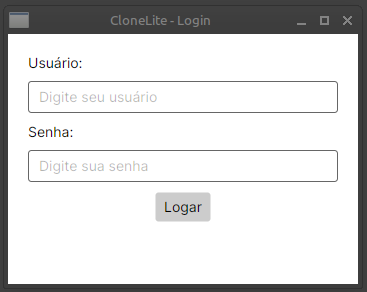
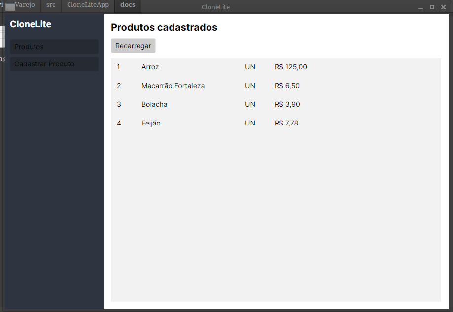

# Clone Lite App

Aplicação desktop para gestão de pequeno varejo, construída em **C#** com **Avalonia UI**, **Entity Framework Core** e **PostgreSQL**.

> Projeto de estudo desenvolvido do zero, com foco em aprender na prática: MVVM, Injeção de Dependência, mapeamento de enums no PostgreSQL e integração entre console e desktop.

---

## 📌 Sobre o projeto

O CloneLite começou como um CRUD de console para treinar C# e evoluiu para uma aplicação desktop completa. A ideia é construir algo real, que eu usaria, em vez de seguir tutoriais isolados.

A migração do console para o Avalonia foi o ponto de virada: foi onde entendi de verdade o que é **MVVM**, para que serve **Injeção de Dependência** e como o **Entity Framework Core** conversa com o **PostgreSQL**.

## Screenshots

### Tela de Login

### Lista de Produtos
